# Web Server Compromise Investigation with Splunk

A SOC-style investigation of a compromised web server, done in Splunk Enterprise during the TryHackMe room **Splunk Basics: Did you SIEM?**. Starting from raw web and firewall logs, I found the attacker, rebuilt the attack chain step by step, and confirmed it with a second log source.

> The data is a training dataset (fictional IPs and a staged scenario), not a real incident.

## Summary

| Item | Finding |
|---|---|
| Data sources | `web_traffic` (17,172 events, 20 days) and `firewall_logs` |
| Attacker IP | `198.51.100.55` (7,876 events, about 46% of all web traffic) |
| Compromised server | `10.10.1.5` |
| Attack chain | Recon, vulnerability testing, SQL injection, data-theft attempts, webshell and RCE, C2 |
| Assessment | Likely full compromise: webshell commands executed and an outbound C2 channel was allowed |

## Methodology

1. **Find the anomaly in time.** Count events per day and look for spikes.
2. **Hunt in fields.** Check `user_agent`, `client_ip` and `path` for values that stand out.
3. **Narrow to one suspect.** Remove normal browser traffic and focus on a single IP.
4. **Trace the chain.** Follow that IP's activity stage by stage.
5. **Confirm with another source.** Pivot to firewall logs to verify the outcome.

## 1. Finding the anomaly

```spl
index=main sourcetype=web_traffic | timechart span=1d count | sort - count | head 5
```

Normal days had roughly 400 to 600 events. Four days were about three times higher: 2025-10-10 (2,012), 2025-10-14 (1,755), 2025-10-11 (1,637) and 2025-10-13 (1,617).

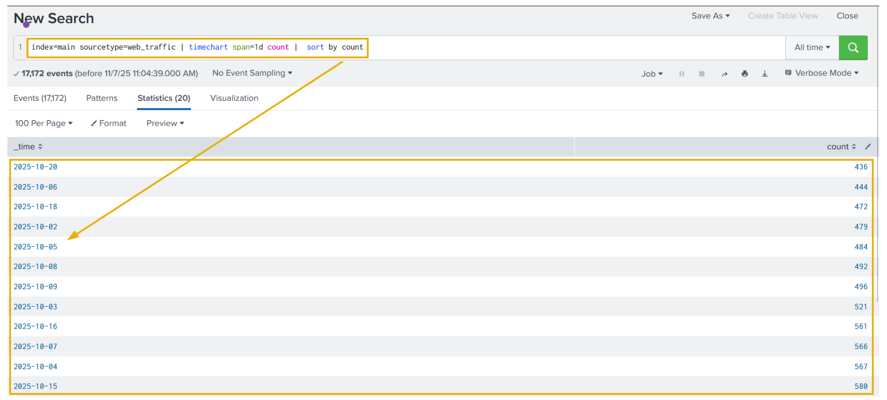
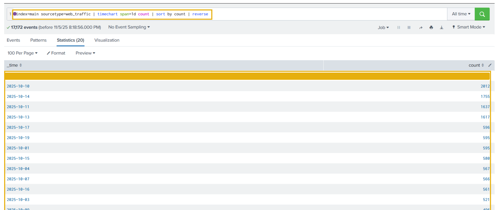

## 2. Hunting for suspicious values

The `user_agent` field showed three normal browsers plus several automated tools, including `sqlmap`, `Havij`, `zgrab`, `curl`, `Wget`, `Go-http-client` and `python-requests`. The `path` field contained a `SLEEP(5)` SQL payload and a `../../etc/passwd` traversal. One `client_ip` had 7,876 events while every other IP had 2 or 3.

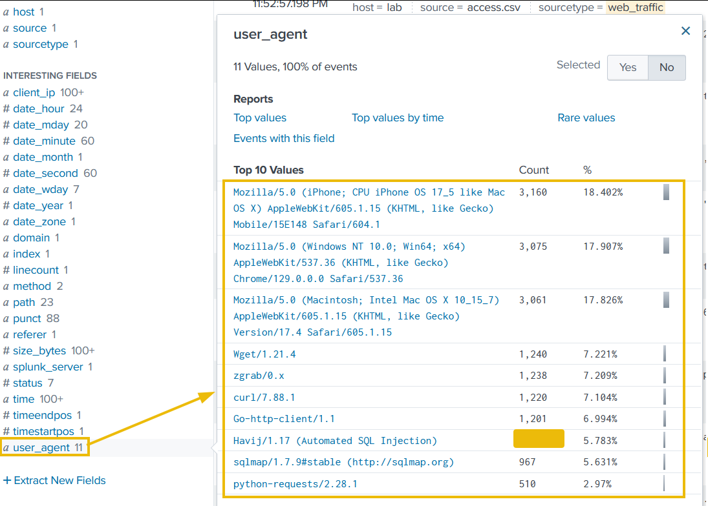
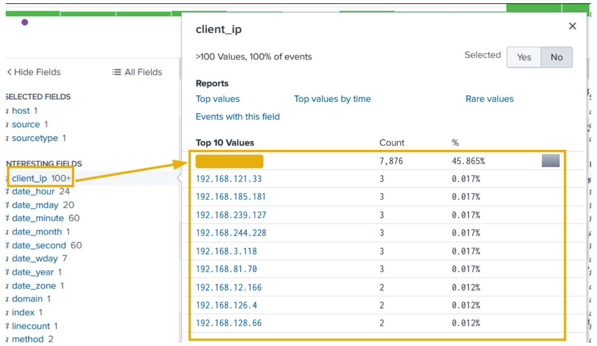
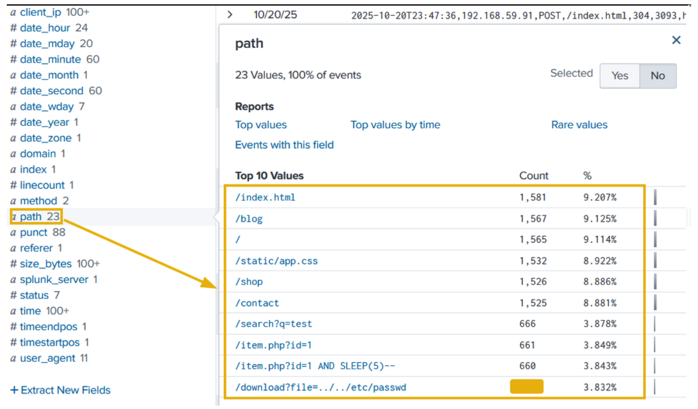

## 3. Isolating the attacker

```spl
index=main sourcetype=web_traffic user_agent!=*Mozilla* user_agent!=*Chrome* user_agent!=*Safari* user_agent!=*Firefox*
| stats count by client_ip | sort -count | head 5
```

After removing browser traffic, all 7,876 remaining events came from one IP: the attacker.

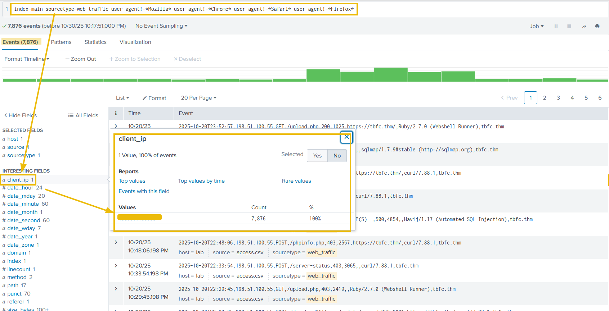
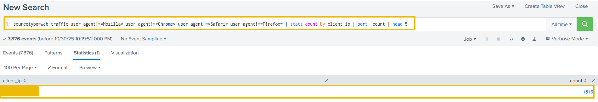

## 4. Attack chain

### Reconnaissance (1,444 events)
```spl
sourcetype=web_traffic client_ip="198.51.100.55" AND path IN ("/.env", "/*phpinfo*", "/.git*")
| table _time, path, user_agent, status
```
Probes for `/.env`, `/.git/config` and `phpinfo.php` using `curl`, `zgrab`, `Wget` and `Go-http-client`. The rows I reviewed returned 401, 403 or 404.

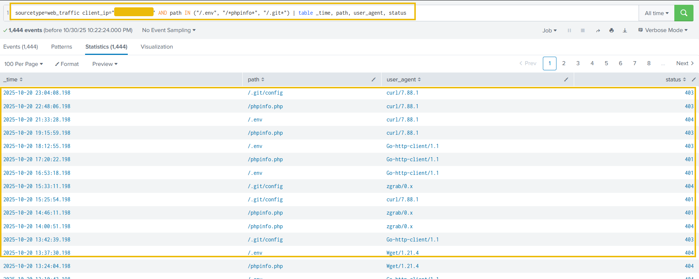

### Enumeration / vulnerability testing (1,291 events)
```spl
sourcetype=web_traffic client_ip="198.51.100.55" AND (path="*..*" OR path="*redirect*")
| stats count by path
```
About 633 open-redirect attempts (`/?redirect=http://evil.site`) and about 658 path-traversal attempts (`/download?file=../../etc/passwd`). The 658 is derived (1,291 minus 633). Some requests returned 200, but the logs have no response body, so success is not proven.

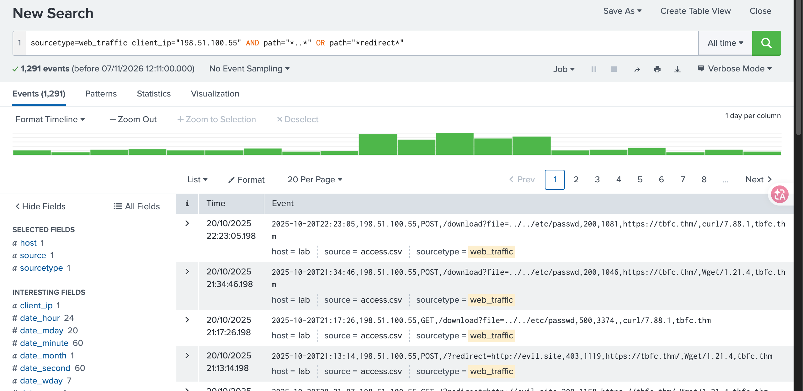
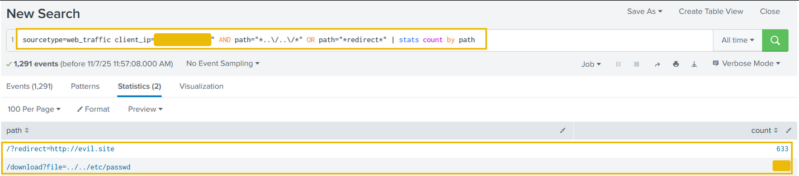

### Exploitation: time-based SQL injection (1,960 events)
```spl
sourcetype=web_traffic client_ip="198.51.100.55" AND user_agent IN ("*sqlmap*", "*Havij*")
| table _time, path, status
```
`SLEEP(5)` payloads against `/item.php?id=` and `/search.php?q=`, from `sqlmap` and `Havij`. Mixed 200, 500 and 504 responses are consistent with injection attempts reaching the database. The logs have no response time, so this is an indicator, not proof.

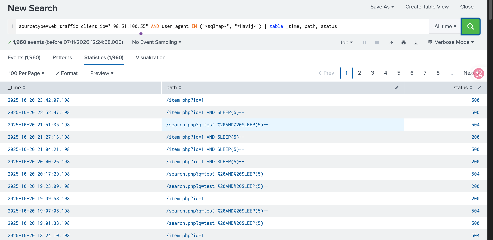

### Data-theft attempts (347 events)
```spl
sourcetype=web_traffic client_ip="198.51.100.55" AND path IN ("*backup.zip*", "*logs.tar.gz*")
| table _time path, user_agent
```
Repeated requests for `/logs.tar.gz` using four different tools. This query did not include `status`, so I treat these as attempts until the response codes and sizes are checked.

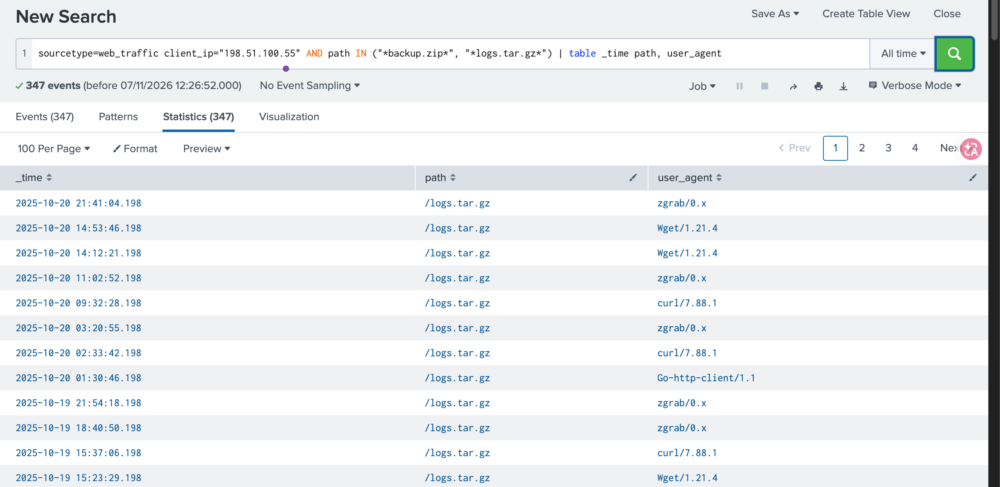

### Webshell and remote code execution (1,092 events)
```spl
sourcetype=web_traffic client_ip="198.51.100.55" AND path IN ("*bunnylock.bin*", "*shell.php?cmd=*")
| table _time, path, user_agent, status
```
Requests to `shell.php?cmd=` ran `whoami`, `chmod +x bunnylock.bin` and `./bunnylock.bin`, with a user agent identifying a "Webshell Runner". The sequence (test the shell, download a binary, make it executable, run it) points to ransomware staging.

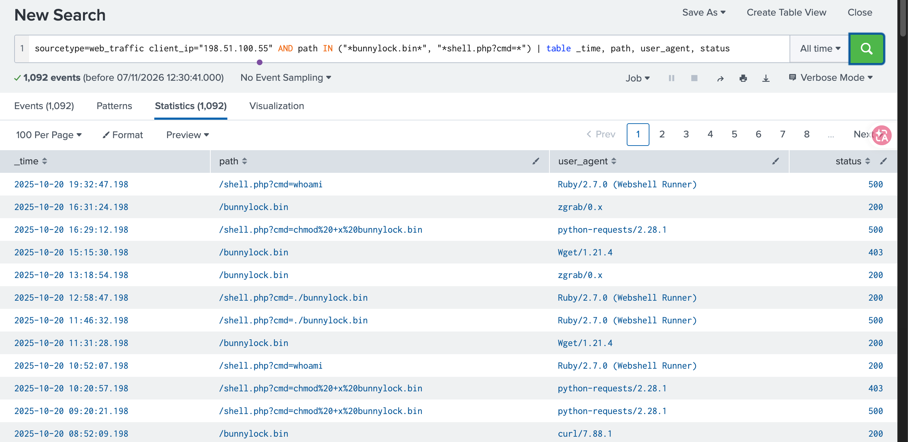

### Command and control, confirmed in the firewall logs (285 connections)
```spl
sourcetype=firewall_logs src_ip="10.10.1.5" AND dest_ip="198.51.100.55" AND action="ALLOWED"
| table _time, action, protocol, src_ip, dest_ip, dest_port, reason
```
The compromised server made repeated outbound TCP connections to the attacker on port 8080, all allowed, all labelled `C2_CONTACT`. The regular pattern looks like beaconing.

```spl
sourcetype=firewall_logs src_ip="10.10.1.5" AND dest_ip="198.51.100.55" AND action="ALLOWED"
| stats sum(bytes_transferred) by src_ip
```
Total transferred: 126,167 bytes (about 123 KB) across 285 connections. That is small, which fits beaconing and commands more than bulk data theft.

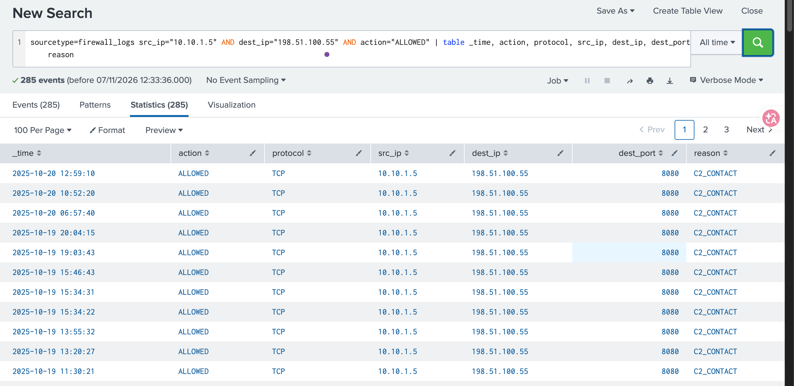
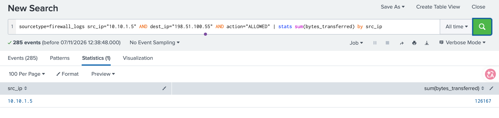

## MITRE ATT&CK mapping

| Stage | Technique |
|---|---|
| Reconnaissance | T1595 Active Scanning |
| Exploitation | T1190 Exploit Public-Facing Application |
| Persistence / access | T1505.003 Web Shell |
| Execution | T1059.004 Unix Shell |
| Tool transfer | T1105 Ingress Tool Transfer |
| Command and control | T1071 Application Layer Protocol |
| Impact (suspected) | T1486 Data Encrypted for Impact |

## Recommended response

- Isolate `10.10.1.5` and block `198.51.100.55` inbound and outbound.
- Review the firewall rule that allowed outbound traffic on port 8080.
- Find and remove `shell.php`, `upload.php` artifacts and `bunnylock.bin`; inspect running processes.
- Rotate credentials and secrets stored on the server.
- Fix the SQL injection, path traversal and open redirect flaws; add WAF rules and alerting on scanner user agents.

## Limitations

- Web logs show requests and status codes, not response content or timing, so "successful" is an inference. I corroborated the most serious findings (webshell commands, C2) with a second source.
- User agents can be spoofed. Here the tool names were explicit and matched the payloads.

## What I learned

SPL basics (`stats`, `timechart`, `sort`, `table`, filtering with `IN` and wildcards), correlating two log sources, and writing findings with appropriate confidence. A query reference is in [Splunk_Cheat_Sheet.pdf](../cheatsheets/Splunk_Cheat_Sheet.pdf).

## Tools

Splunk Enterprise 8.2.6, TryHackMe (Splunk Basics: Did you SIEM?)
