# Exploring SPL: Searching, Transforming and Detecting Anomalies in Splunk

Notes and screenshots from the TryHackMe room **Splunk: Exploring SPL**. The goal was to go from basic searches to the commands analysts use to summarise logs and find outliers, ending with two anomaly detection queries on VPN logs.

> The data is a training dataset (`windowslogs` and `vpnlogs` indexes), not a real environment.

## Summary

| Area | Commands practised |
|---|---|
| Searching | free text, time ranges, relational and logical operators, wildcards, parentheses |
| Filtering | `fields`, `dedup`, `rename`, `regex` |
| Structuring | `table`, `head`, `tail`, `sort`, `reverse`, `join` with subsearches |
| Transforming | `stats`, `chart`, `timechart`, `top`, `rare`, `highlight` |
| Enrichment | `iplocation`, `lookup`, `eval` with `case` |
| Detection | `eventstats`, `where`, z-score on login hour |

## 1. Searching

Free-text search works when field names are unknown. For anything more precise, searches use parsed fields with operators: `=`, `!=`, `<`, `>`, `AND`, `OR`, `NOT`, `IN`, and wildcards (`*`).

Time range matters as much as the query. Narrowing the window to one minute turned the whole index into 134 events.

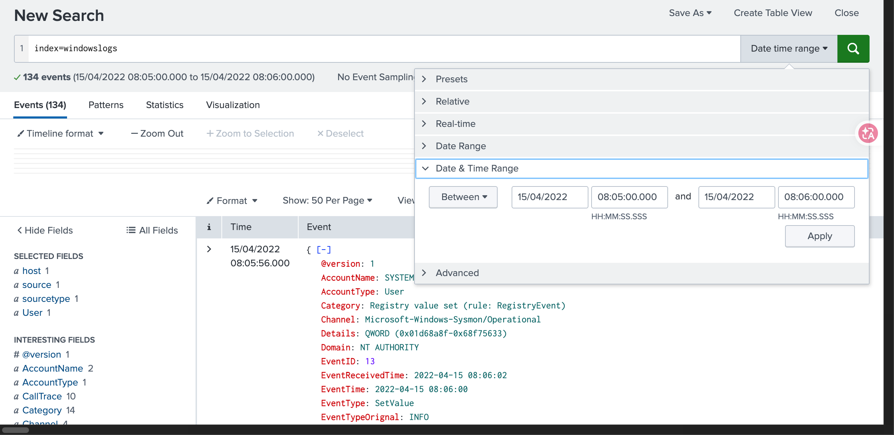

```spl
index=windowslogs AccountName!=SYSTEM
index=windowslogs AccountName!=SYSTEM AND AccountName=James
index=windowslogs DestinationIp=172.*
index=windowslogs DestinationIp=172.18.39.6 AND DestinationPort=135
```


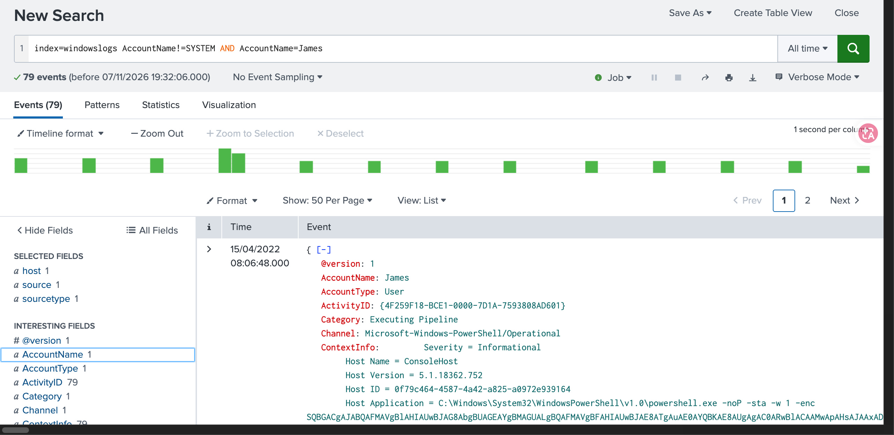
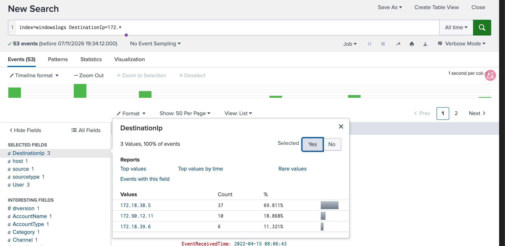
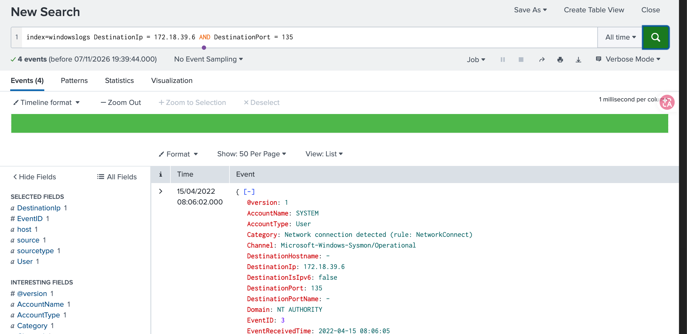

**Order of evaluation:** `OR` is evaluated before `AND`, so `a AND b OR c` does not mean `(a AND b) OR c`. I use parentheses every time to avoid wrong results.

## 2. Filtering results

```spl
index=windowslogs | fields EventID User Image Hostname SourceIp | dedup SourceIp
index=windowslogs | fields EventID User Image Hostname SourceIp | rename User as Employee
index=windowslogs | regex Image="\.exe$"
index=windowslogs | regex TargetObject="Manager$"
```

- `fields` keeps only the columns that matter.
- `dedup` collapses repeated values (seven distinct source IPs became seven events).
- `rename` makes output readable for reports.
- `regex` matches patterns, such as values that end with `.exe`.

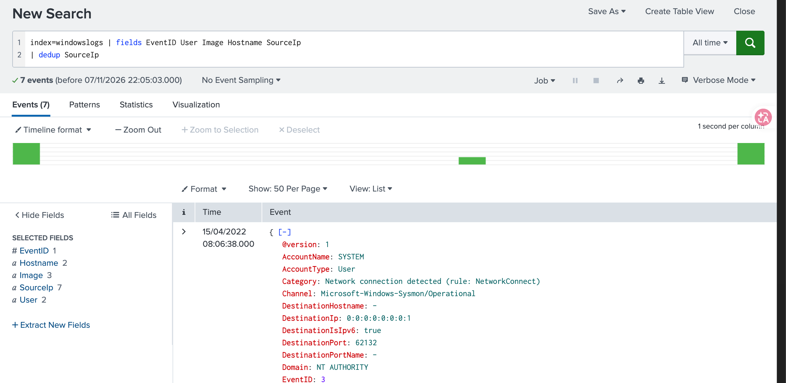
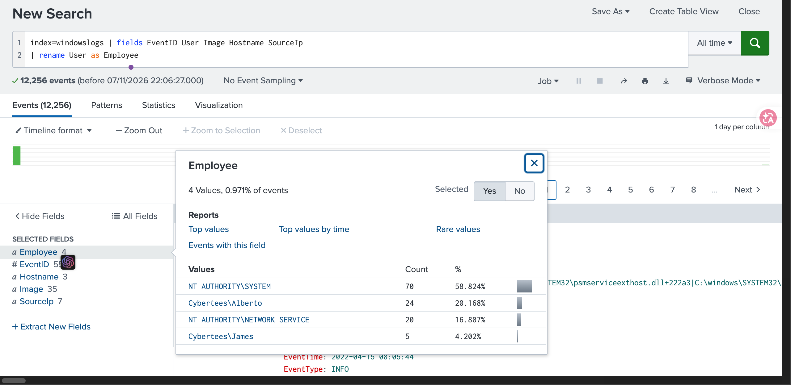
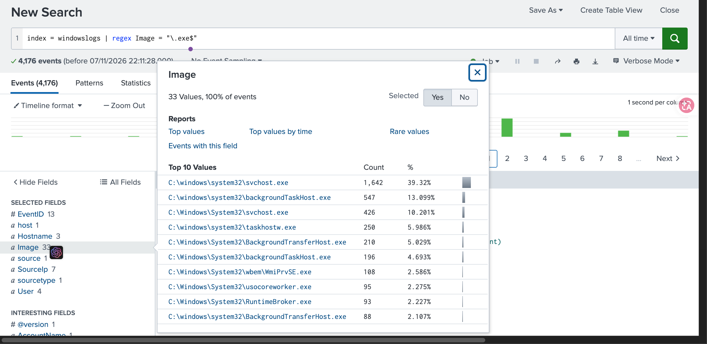
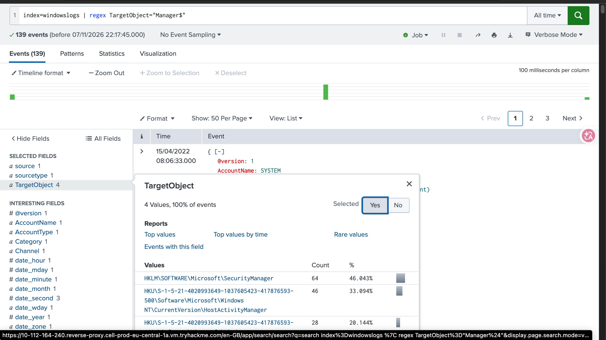

## 3. Structuring results and timelines

```spl
index=windowslogs | table _time EventID Hostname SourceName
index=windowslogs Hostname=Salena.Adam | table _time EventID Hostname SourceName
```

`table` plus `reverse` builds a chronological timeline for one host, which is the basic move when reconstructing what happened on a system. The room also covers `join` with a subsearch to enrich Sysmon process events with logon details from Security events, and notes that `stats` is usually faster on large data.

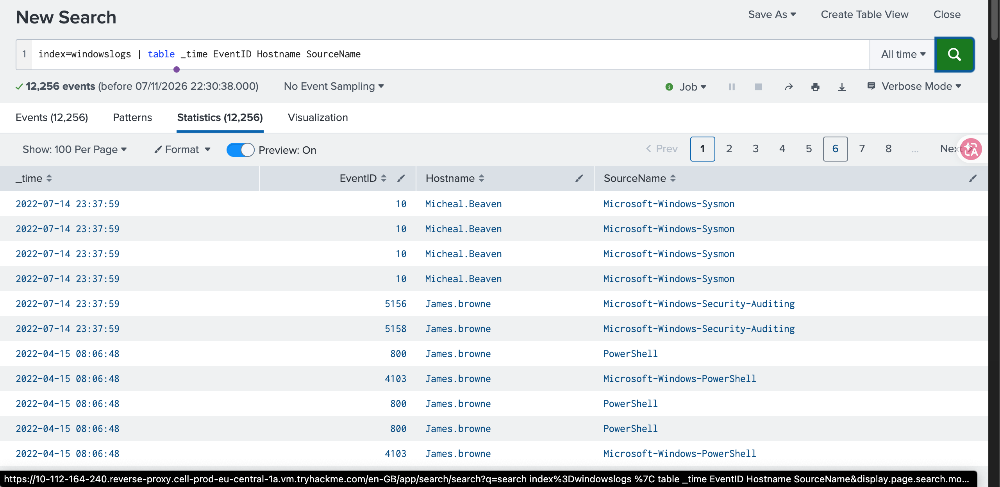
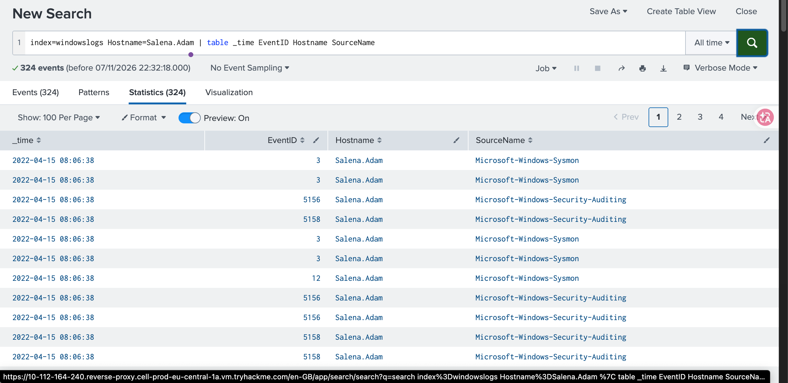

## 4. Transforming results

```spl
index=windowslogs | stats count by EventID | sort EventID
index=windowslogs | chart count by User
index=windowslogs | top Image limit=5
```

`stats`, `chart` and `top` turn thousands of events into a short summary. Counting events per `EventID` shows at a glance which event types dominate the logs.

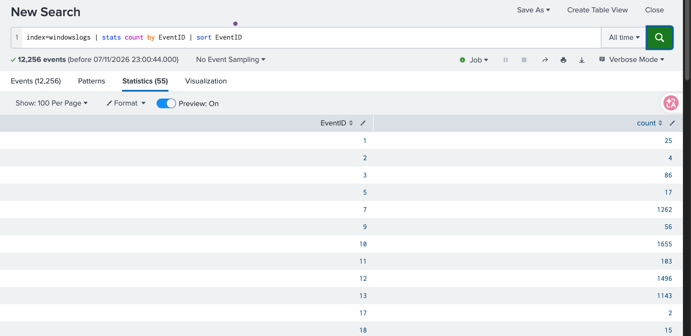
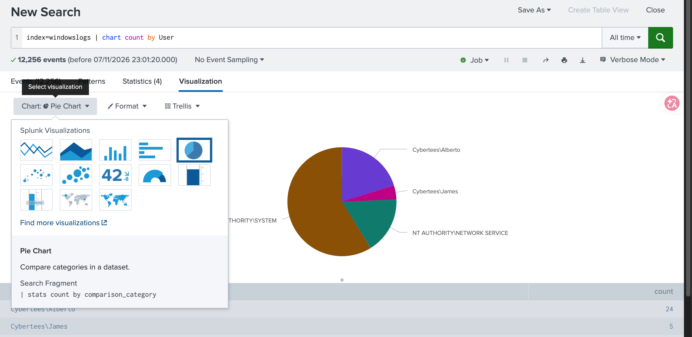
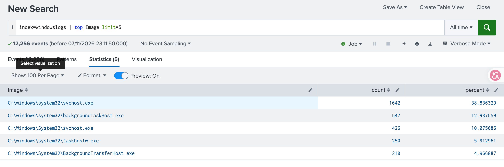

## 5. Enriching data

```spl
index=windowslogs | iplocation SourceIp | stats count by Country
index=windowslogs | lookup user_roles Hostname OUTPUT UserRole | stats count by Hostname UserRole
index=windowslogs
| eval LogonTypeDesc = case(LogonType == 3, "Network Logon", LogonType == 5, "Service")
| stats count by LogonType LogonTypeDesc
```

- `iplocation` adds geographic context to IPs.
- `lookup` joins events with a CSV, here mapping hosts to job roles. A role makes activity easier to judge: a system administrator running admin tools is normal, a sales manager doing the same is not.
- `eval` with `case` converts numeric logon types into readable labels.

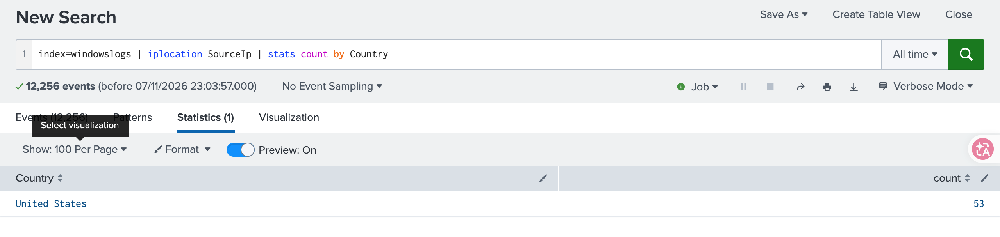
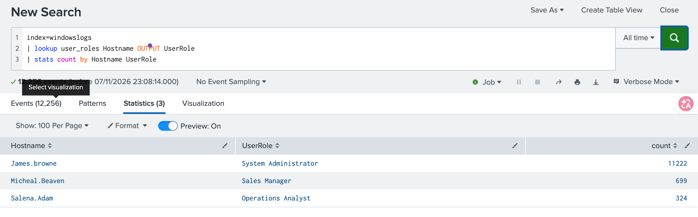
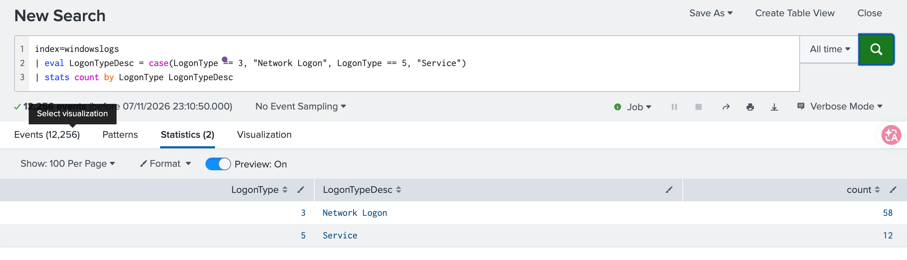

## 6. Anomaly detection on VPN logs

Two approaches, both using `eventstats` so the original events are kept for further filtering.

**By country (rare user and country pairs).** For each user, count total logins and logins per country, compute the share, and keep pairs below a threshold:

```spl
index=vpnlogs
| eventstats count as logins_by_user by user
| eventstats count as logins_by_user_country by user src_country
| eval country_freq=logins_by_user_country/logins_by_user
| where country_freq < 0.1
| table _time user src_ip src_country country_freq
```

Out of 2,000 logins, only two events were flagged: users who logged in once from a country they never normally use.

**By hour (z-score).** Each user has a typical login hour and a spread. The z-score is how many standard deviations a login is from that user's norm:

```spl
index=vpnlogs
| eval hour=tonumber(strftime(_time, "%H")) + tonumber(strftime(_time, "%M"))/60
| eventstats avg(hour) as typical_hour stdev(hour) as stdev_hour by user
| eval zscore=abs(hour - typical_hour) / stdev_hour
| where zscore > 3
| eval hour=round(hour, 2), typical_hour=round(typical_hour, 2)
| eval stdev_hour=round(stdev_hour, 2), zscore=round(zscore, 2)
| table _time user src_ip src_country hour typical_hour stdev_hour zscore
| sort - zscore
```

Two logins were flagged. One user who normally logs in around 13:30 appeared at about 03:17, with a z-score above 5. Note that the room's version ends with `sort - hour_zscore`, a field that does not exist; sorting by `zscore` is the correct form.

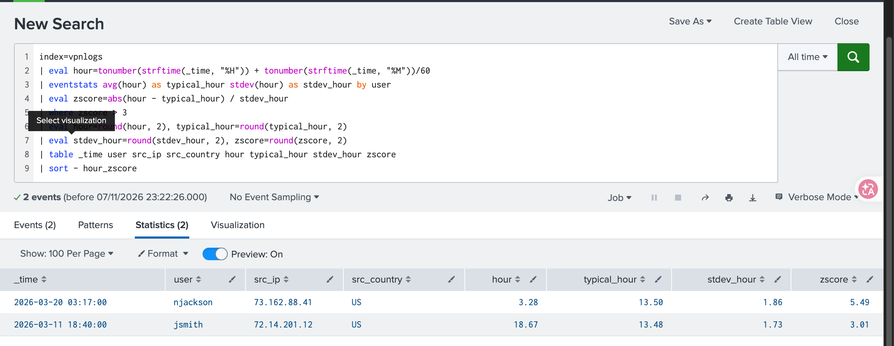

## Limitations of these detections

- **Statistics need enough history per user.** A user with very few logins gives an unreliable average and standard deviation, and a standard deviation of 0 causes a division by zero.
- **Time zones and shift work change what "normal" means.** The hour calculation uses UTC, so a night-shift employee looks anomalous all the time.
- **An outlier is a lead, not a verdict.** A rare country could be travel or a VPN. These queries produce candidates for an analyst to review, ideally together with threat intelligence or `iplocation` data.
- **The hour average does not handle midnight wrap-around well.** Logins at 23:30 and 00:30 are an hour apart but far apart numerically.

## What I learned

How to build a search step by step with pipes, summarise large logs with `stats` and `top`, enrich events with `lookup` and `iplocation`, and write simple statistical detections instead of eyeballing logs. This builds on [my Splunk Basics investigation](../thm-splunk-basics-web-attack/) and the [cheat sheet](../cheatsheets/Splunk_Cheat_Sheet.pdf).

## Tools

Splunk Enterprise 9.4.9, TryHackMe (Splunk: Exploring SPL)
